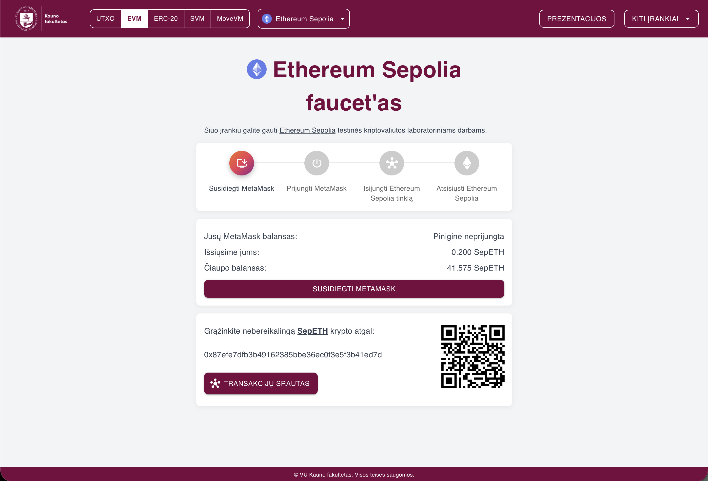

# Crypto Faucet

A comprehensive multi-blockchain faucet system developed for Vilnius University. This platform provides free testnet tokens for various blockchain networks, educational tools, and DApp hosting capabilities.



<br/>

## 🚀 Features

### Multi-Blockchain Faucet Support
- **UTXO-Based Networks**:
  - KNF Coin (faculty's own blockchain)
  - Bitcoin Testnet4
  - Litecoin Testnet4

- **EVM-Compatible Networks**:
  - Ethereum Sepolia Testnet
  - zkSync Sepolia Testnet
  - Linea Sepolia Testnet
  - Ethereum Hoodi Testnet
  - Arbitrum Sepolia Testnet
  - Polygon Amoy Testnet

- **SVM Networks** (Solana runtime — Phantom wallet, Ed25519 addresses):
  - Solana Devnet

- **Move Networks** (Sui — any Wallet-Standard Sui wallet such as Slush or Suiet):
  - Sui Testnet

- **ERC-20 Test Tokens** (token-first — one page per token, across every chain it is deployed on):
  - Chainlink (LINK) on Sepolia

### Educational Tools
- **Blockchain Simulator**: Interactive SHA-256 blockchain demonstration
- **Transaction Graph Visualizer**: Explore cryptocurrency transaction flows (See [more](_DOCS/txgraph/README.md))
- **DApp Hosting**: File browser and hosting for decentralized applications

<br/>

## 📋 Prerequisites

- Docker and Docker Compose
- Infura API key (for EVM networks)
- Etherscan API key (optional, for the transaction graph)

<br/>

## 🚀 Quick Start

### 1. Clone the Repository
```bash
git clone https://github.com/kaunofakultetas/crypto-faucet.git
cd crypto-faucet
```

### 2. Configure Environment
Copy the sample configuration:
```bash
cp docker-compose.sample.yml docker-compose.yml
```

Create a `.env` file next to `docker-compose.yml` with your secrets (the compose file reads them via `${...}` substitution):
```bash
INFURA_PROJECT_ID=your_infura_project_id
ETHERSCAN_API_KEY=your_etherscan_api_key
FAUCET_PRIVATE_KEY=your_faucet_wallet_private_key
DBGATE_PASSWORD=your_db_admin_password
```

Then set the GUI login password in `docker-compose.yml` (service `faucet-endpoint` → `APP_PASSWORD_1`).

### 3. Deploy Stack
```bash
./runUpdateThisStack.sh
```

### 4. Access the Application
- **Main Interface**: `http://<server-ip>` (or your configured domain)
- **GUI Password**: the `APP_PASSWORD_1` you set above
- **Database Browser**: `/dbgate` (login `admin` + your `DBGATE_PASSWORD`)

<br/>

## 🔧 Configuration

### Environment Variables

| Variable | Description | Default | Required |
|----------|-------------|---------|----------|
| `INFURA_PROJECT_ID` | Infura API project ID | - | ✅ |
| `FAUCET_PRIVATE_KEY` | Private key of the faucet wallet — one secret, shared by EVM, ERC-20, UTXO, SVM and Move; it derives a DIFFERENT address per family (the Sui one is the key hashed as an Ed25519 seed), each funded separately | - | ✅ |
| `DBGATE_PASSWORD` | Password of the `/dbgate` database browser | - | ✅ |
| `APP_PASSWORD_1` | System GUI access password (set in compose, not `.env`) | - | ✅ |
| `ETHERSCAN_API_KEY` | Etherscan API key (transaction graph) | - | ❌ |
| `APP_DEBUG` | Flask debug mode (development only) | false | ❌ |

### Coins & Icons — the `_CONFIG` Directory

All networks and tokens are defined in **`_CONFIG/coins.py`**, which is mounted read-only into the backend container (`./_CONFIG:/config`) — so the coin catalog lives *outside* the images and can be changed without rebuilding anything:

- **`_CONFIG/coins.py`** holds five maps: `EVM_NETWORK_CONFIGS`, `ERC20_TOKEN_CONFIGS`, `UTXO_NETWORK_CONFIGS`, `SVM_NETWORK_CONFIGS`, `MOVE_NETWORK_CONFIGS`. Emptying a map disables that whole family (the navbar hides it). Each entry is sectioned by who consumes the settings (`faucet` / `metamask` / `wallet` / `explorer`). The file is validated on boot — a typo kills the start with a precise error in `docker logs faucet-backend` instead of a silent fallback. The Infura key never sits in this file: `<INFURA_PROJECT_ID>` inside `rpc_url` is substituted from the environment at startup.
- **`_CONFIG/icons/<type>/<key>.svg`** (or `.png` / `.webp`) holds the asset icons, where `<type>` is `evm` / `erc20` / `utxo` / `svm` / `move` and `<key>` is the entry's key in the maps (e.g. `evm/sepolia.svg`, `erc20/LINK.svg`, `utxo/btc4.svg`, `svm/solanaDevnet.svg`, `move/suiTestnet.svg`). Assets without an icon file automatically fall back to a colored dot in the UI.

The UTXO, SVM and Move entries name a *coin* / *chain* plus a network flavour (`bitcoin` + `testnet`, `solana` + `devnet`, `sui` + `testnet`); everything protocol-precise — address version bytes, fee rates, dust limits, lamport/MIST decimals, rent-exempt minimums, gas margins — lives in the backend's in-code registries (`app/utxo_faucet/coins/`, `app/svm_faucet/chains/`, `app/move_faucet/chains/`) and is never an operator setting. An unknown coin/chain, an unknown flavour, or an SVM `chunk_size` below the chain's rent-exempt minimum all fail the boot.

**To add or change a coin**: edit `_CONFIG/coins.py`, then `docker restart faucet-backend` (~3 s).
**To add or change an icon**: drop the file into `_CONFIG/icons/` — it appears on the next page load, no restart at all.

<br/>

## 📚 Usage

### Requesting Testnet Tokens

#### UTXO Networks (KNF, Bitcoin, Litecoin)
1. Navigate to `/faucet/utxo/{network}` (e.g., `/faucet/utxo/btc4`, `/faucet/utxo/ltc4`, `/faucet/utxo/knf`)
2. Enter your testnet address
3. Click the request button
4. Receive testnet cryptocurrency at your address

#### EVM Networks (Ethereum-like)
1. Navigate to `/faucet/evm/{network}` (e.g., `/faucet/evm/sepolia`)
2. Connect your MetaMask wallet and switch to the network (the page adds it to MetaMask if missing)
3. Sign the verification message — no transaction, the signature only proves you own the address
4. Receive testnet ETH in your wallet

#### SVM Networks (Solana-like)
1. Navigate to `/faucet/svm/{network}` (e.g., `/faucet/svm/solanaDevnet`)
2. Connect your Phantom wallet
3. Put Phantom on Devnet — **Settings (⚙️) → Developer Settings → Testnet Mode**, then pick *Solana Devnet* (not *Solana*) in the network list. Phantom cannot always be switched by the page, so the instructions stay on screen until it confirms the hop; coins always go to Devnet, and a wallet left on mainnet will not show them
4. Sign the verification message — no transaction, the Ed25519 signature only proves you own the address
5. Receive testnet SOL in your wallet

#### Move Networks (Sui)
1. Navigate to `/faucet/move/{network}` (e.g., `/faucet/move/suiTestnet`)
2. Connect your Sui wallet (Slush, Suiet or any other Wallet-Standard wallet — the page shows whichever it finds) — there is no network step, a Sui address is the same on every network
3. Put the wallet on **Testnet** in its own network selector (it ships on Mainnet) — the page names the network to select and turns amber while the wallet reports another one
4. Sign the verification message — no transaction, the signature only proves you own the address
5. Receive testnet SUI in your wallet

#### ERC-20 Tokens
1. Navigate to `/faucet/erc20/{token}` (e.g., `/faucet/erc20/LINK`) — one page shows the token on **every** chain it is deployed on
2. Connect MetaMask and switch to one of the token's networks
3. Hold some native crypto there first — receiving tokens is free, but *using* them costs gas, so each chain requires at least **half the native faucet's chunk** before its claim button unlocks (the page links to the right native faucet if you're short)
4. Claim, then press **"Rodyti MetaMask"** on the chain card — it switches the wallet and imports the token contract, since freshly received ERC-20s are invisible in MetaMask until imported

### Educational Tools

#### Blockchain Simulator
- Access at `/sha256`
- Interactive demonstration of blockchain concepts
- Mine blocks and explore hash functions

#### Transaction Graph (See [more](_DOCS/txgraph/README.md))
- Access at `/graph/{network}` — reached from the graph button on an EVM faucet page
- Visualize cryptocurrency transaction flows, one day at a time (the slider offers the days the faucet transacted on)
- Explore addresses and transaction relationships
- Only for EVM networks with an `explorer` section in `_CONFIG/coins.py` (an Etherscan-style API)

### DApp Hosting
- Upload static files via `/dapps` file browser
- Host decentralized applications
- Manage hosted content

